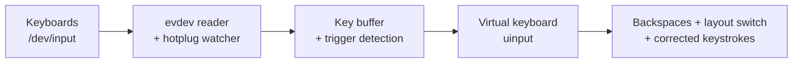

# gswitch-auto

[](https://github.com/vabuter/gswitch-auto/actions/workflows/ci.yml)
[](https://github.com/vabuter/gswitch-auto/releases)
[](https://github.com/arumata/gswitch)
[](LICENSE)

## About this fork

**gswitch-auto** is a fork of [gswitch](https://github.com/arumata/gswitch)
that adds Punto Switcher-style **automatic correction** of the last word typed
in the wrong keyboard layout. Upstream declined automatic correction (issues
#12 and #31), so this is a separate fork that is rebased onto every upstream
release ([docs/FORK.md](docs/FORK.md), in Russian). Please report problems with
the fork [here](https://github.com/vabuter/gswitch-auto/issues), not upstream.

> **Status:** in development. The first release will be `v0.8.0+auto.1`;
> until then `make rpm` builds development packages versioned
> `0.8.0+auto.0.dev<n>.g<commit>`, which already replace upstream 0.8.0.

What the fork adds on top of upstream 0.8.0:

- **Automatic mode, off by default.** When you press <kbd>Space</kbd> after a
  word that is clearly English typed in the Russian layout or Russian typed in
  the English layout (`ghbdtn` → `привет`, `руддщ` → `hello`), the daemon
  waits for a short pause, erases the word, switches the layout and retypes it.
  The layout stays switched, so you can keep typing. <kbd>Enter</kbd> never
  triggers a correction, and any key pressed during the pause cancels it.
- **Undo.** Double <kbd>Shift</kbd> right after an automatic correction
  restores the original word and layout. The undone word can be learned as an
  exception.
- **Toggle chord.** Press <kbd>LShift</kbd>+<kbd>RShift</kbd> together and
  release them to turn automatic mode on or off. The tray menu shows the state,
  and the setting is saved.
- **Selection chord.** <kbd>LShift</kbd>+<kbd>RAlt</kbd>+<kbd>RCtrl</kbd>
  converts the selected text; upstream's Ctrl + double Shift still works.
  Press Shift first: with RAlt first, GNOME's `<Alt>Shift_L` layout shortcut
  can fire, and the daemon then restores the layout.
- **Exceptions.** A list of words that are never corrected and a list of
  applications where automatic mode is off. Terminals, password fields and the
  lock screen are skipped by default.
- **Settings.** The tray's settings window gets an "Auto correction" tab with
  all of the above, configurable hotkeys, and service controls (start, stop,
  restart, start at login, status). The fork's new interface strings exist in
  English and **Russian**; upstream's other interface languages show them in
  English.

All upstream gestures keep working unchanged: double Shift for the last word,
the held-Shift phrase gesture, Ctrl + double Shift for the selection, case
swap, a custom convert key, and undo by repeating the trigger.

**Scope.** Automatic mode supports the `us` + `ru` layout pair on GNOME Shell
50 under Wayland with IBus (the active layout is read from IBus); packages are
built for Fedora 44, x86_64. On X11, KDE, other layout pairs or without IBus,
automatic mode reports itself as unavailable and gswitch behaves exactly like
upstream. The language detector is a Go port of
[punto-rs](https://github.com/rashevskyv/punto-rs)' Bloom filter and
letter-trigram model. It runs locally in microseconds, with no network access
and no LLM.

### Install

```bash
make rpm                                      # or download the RPM from Releases
rpm -U --test ./dist/gswitch-auto-*.rpm       # optional dry run: changes nothing, needs no root
sudo dnf install ./dist/gswitch-auto-*.rpm    # replaces the upstream gswitch package
systemctl --user enable --now gswitch.service # only if it is not already running
```

The `gswitch-auto` package provides `gswitch`, obsoletes `gswitch < 0.9` and
keeps the binary names and file paths, so it replaces an installed upstream
package in place. If upstream's service was enabled, the package enables it again
after the replacement. Log out and back in once afterwards, so that GNOME Shell
loads the bundled extension (needed for application exclusions) and the new
tray starts. Rollback:
`sudo dnf swap gswitch-auto ./gswitch_0.8.0_linux_amd64.rpm`, then
`systemctl --user enable --now gswitch.service`. Build requirements and make
targets are listed in [CONTRIBUTING.md](CONTRIBUTING.md).

### Configuration: `~/.config/gswitch`

`/etc/gswitch/default.conf` keeps upstream's meaning. Fork settings are stored
per user in `$XDG_CONFIG_HOME/gswitch` (usually `~/.config/gswitch`, mode 0700,
files 0600) next to upstream's `ui.conf`. The tray writes these files; the
daemon only reads them and picks up changes without a restart.

`auto.conf` uses upstream's `key=value` syntax (`#` comments):

| Key | Default | Meaning |
|---|---|---|
| `auto-enabled` | `false` | Automatic mode on/off (also toggled by the chord, the tray and D-Bus) |
| `auto-min-letters` | `3` | Shortest word that is checked (2–8) |
| `auto-max-letters` | `24` | Longest word that is checked (4–64) |
| `auto-short-words` | `true` | Also fix common two-letter words from a closed list |
| `auto-margin` | `1.0` | Required detector margin, bits per letter (0–5) |
| `auto-max-alt-cost` | `7.0` | Maximum trigram cost of the converted word (3–25.5) |
| `auto-holdoff-ms` | `120` | Quiet time after Space before a correction fires (30–1000) |
| `auto-min-interval-ms` | `1000` | Minimum time between two corrections (0–10000) |
| `auto-delay-ms` | `3` | Delay between replayed key events; `0` uses upstream `delay` |
| `auto-switch-delay-ms` | `60` | Pause after the confirmed layout switch; `0` uses upstream `layout-switch-delay` |
| `auto-learn-on-undo` | `true` | Add an undone word to the exception list |
| `auto-learn-undo-count` | `1` | Undos of the same word before it is learned (1–10) |
| `auto-require-focus` | `false` | Disable automatic mode while the GNOME Shell extension is unavailable |
| `auto-skip-password` | `true` | Skip password and PIN fields |
| `auto-skip-terminal` | `true` | Skip terminals |
| `auto-skip-locked` | `true` | Skip while the screen is locked |
| `hotkey-toggle-auto` | `42+54` | Toggle chord as evdev scancodes (LShift+RShift), or `none` |
| `hotkey-convert-selection` | `42+97+100` | Selection chord (LShift+RCtrl+RAlt), or `none` |
| `ipc-expose-words` | `true` | Include corrected and learned words in D-Bus properties and signals |
| `focus-source` | `auto` | `auto` or `off` (restart required) |
| `layout-source` | `auto` | `auto`, `ibus` or `none` (restart required) |
| `layout-hint-timeout-ms` | `400` | How long a physical layout-switch chord marks the layout as pending (restart required) |

Invalid values fall back to the default with a warning; unknown keys are
ignored. `exceptions-words.txt` and `exceptions-apps.txt` hold one entry per
line (`#` starts a comment). Words are matched case-insensitively against the
word as it appeared on screen before the correction, with `ё` folded to `е`
and edge punctuation ignored. Applications are matched by GNOME desktop id or
WM_CLASS (`org.gnome.Ptyxis`, `kitty`; `*` and `?` wildcards work); the
default list contains common terminals and KeePassXC.

### Command line additions

```text
gswitch --auto-check <text> [--shown us|ru]  # run the detector on a word, JSON verdict
gswitch --layout-state [--watch SECONDS]     # show the IBus layout tracker state
```

`--auto-check ghbdtn --shown us` reports a fix to `привет`: `verdict` and
`reason` are the detector's, `engine` is what automatic correction would do
(`arm`, or the reason it skips the word, such as `lexical:digit` for
`ghb2`). Without `--shown`, the layout is inferred from the text. It uses
the detector settings and exception words from `~/.config/gswitch`.
`--layout-state` prints the layout pair, the IBus bus address and the active
engine with the layout it maps to (`xkb:ru::rus` → `ru`, index 1), then
follows changes for 10 seconds (`--watch 0` prints once). Neither needs root
or input devices.

### D-Bus interface

The daemon owns `io.github.vabuter.GswitchAuto` on the session bus (object
`/io/github/vabuter/GswitchAuto`, same interface name). It is not
bus-activatable; the systemd user unit is the only launcher. A second daemon
instance (for example `gswitch --debug` next to the service) runs without IPC.

- Properties: `AutoEnabled` (read-write), `AutoEnabledUnsaved`,
  `PendingLearnedWords`, `AutoAvailable`, `AutoUnavailableReason`,
  `ActiveLayout`, `LayoutKnown`, `LayoutSource`, `FocusSource`, `FocusedApp`,
  `FocusedWmClass`, `InputPurpose`, `FocusSuppressed`,
  `FocusSuppressedReason`, `LastCorrection`, `CorrectionCount`, `Stats`,
  `ToggleChord`, `SelectionChord`, `HotkeysSuspended`, `ConfigDir`,
  `ConfigWarnings`, `Version`.
- Methods: `SetAutoEnabled(b)`, `Reload()`, `SuspendHotkeys(b)` (used by the
  key picker; released when the caller disconnects or after 120 s).
- Signals: `AutoEnabledChanged(b enabled, s source)`,
  `Corrected(s from, s to, s direction, t time)`,
  `CorrectionUndone(s word, b learned)`.

```bash
busctl --user introspect io.github.vabuter.GswitchAuto /io/github/vabuter/GswitchAuto
busctl --user set-property io.github.vabuter.GswitchAuto /io/github/vabuter/GswitchAuto \
    io.github.vabuter.GswitchAuto AutoEnabled b true
```

### GNOME Shell extension

GNOME Wayland does not tell other programs which window has focus, so the
package installs a small extension, `gswitch-focus@vabuter.github.io`, into
`/usr/share/gnome-shell/extensions/`. It publishes the focused application's
desktop id, its WM_CLASS and the purpose of the focused text field (normal,
password, terminal, …) as `org.gnome.Shell.Extensions.GswitchFocus` on the
session bus. It exposes no window titles, no text and no process ids, and it
is disabled by GNOME Shell on the lock screen.

GNOME Shell loads new or updated extensions only at login: log out and back in
after installing or upgrading, then enable it in the tray settings (Auto
correction tab, Excluded applications, **Enable**) or with
`gnome-extensions enable gswitch-focus@vabuter.github.io`; no second login is
needed. Before that login, `gnome-extensions enable` fails because the running
Shell has not seen the extension; the tray's **Enable at next login** button
adds it to `org.gnome.shell enabled-extensions` instead. Without the
extension, application exclusions and password/terminal detection are
inactive and automatic mode keeps working elsewhere; set
`auto-require-focus=true` to turn automatic mode off instead.

### Privacy and persistence

- The daemon keeps upstream's sandbox: the systemd user unit is unchanged
  (`ProtectHome=read-only`), and the daemon writes nothing under `$HOME`.
  New connections are the session bus and the IBus bus (both AF_UNIX); there
  is still no network code.
- Typed text is not stored. The only words written to disk are exception
  words: the ones you add, and words learned on undo, which the tray appends
  to `exceptions-words.txt` (0600).
- Corrected and learned words appear on the session bus (`Corrected`,
  `LastCorrection`, `CorrectionUndone`, `PendingLearnedWords`) only while
  `ipc-expose-words=true`; with `false`, words learned on undo stay in daemon
  memory and are not saved, and words captured meanwhile stay hidden after
  the setting returns to `true`. The daemon never logs words unless run with
  `--debug` and `GSWITCH_AUTO_LOG_WORDS=1`.
- Because the daemon cannot write to your home directory, a toggle made with
  the chord or over D-Bus and words learned on undo are saved by the tray.
  Without a running tray they last until the daemon restarts; the tray saves
  them when it starts again.

### Credits

- [gswitch](https://github.com/arumata/gswitch) by arumata and contributors
  (MIT): everything this fork builds on.
- [punto-rs](https://github.com/rashevskyv/punto-rs) (MIT, © 2026
  netherguy4): the language detector design and the embedded models.
- The Russian model is a modified form of the Russian hunspell dictionary
  (hunspell-ru 0.99g5, © 1997–2008 Alexander I. Lebedev,
  BSD-3-Clause-Modification), stored as a Bloom filter and a letter-trigram
  model; the English model derives from the public-domain `words` list
  (`/usr/share/dict/words`). The Ukrainian model of punto-rs is not included.
  Licence texts
  and notices are installed under `/usr/share/licenses/gswitch-auto/`; see
  `third_party/punto-rs/NOTICE.md`.

---

*The rest of this file is upstream gswitch's README, kept as is. Where it says
that gswitch does not guess your language or changes text only when you press
a trigger, it describes the manual mode; automatic mode is opt-in. Fork
packages are named `gswitch-auto`, come from
[this fork's releases](https://github.com/vabuter/gswitch-auto/releases), and
are built with nfpm (`scripts/build-rpm.sh`) rather than GoReleaser.*

# gswitch

[](https://github.com/arumata/gswitch/releases)
[](https://github.com/arumata/gswitch/actions/workflows/ci.yml)
[](go.mod)
[](LICENSE)

**gswitch** fixes text typed in the wrong keyboard layout, system-wide on X11
and Wayland. It does not guess your language or change text in the background.
You press a trigger when you want a correction.

You typed a word, but the wrong layout was active:

| You got | You meant | Layout pair |
|---|---|---|
| `ghbdtn` | `привет` | English ↔ Russian |
| `ghbdsn` | `привіт` | English ↔ Ukrainian |
| `yeit` | `zeit` | English ↔ German (QWERTZ) |
| `qwerty` | `azerty` | English ↔ French (AZERTY) |
| `espa;ol` | `español` | English ↔ Spanish |

By default, double-tap <kbd>Shift</kbd> to fix the last word. Hold one
<kbd>Shift</kbd> and double-tap the other to fix the current phrase. You can
also convert selected text, swap its case, or repeat a correction immediately
to undo it. If Double Shift conflicts with an IDE or another application,
choose Pause/Break, Scroll Lock, or another single key in Settings.

Word and phrase correction runs at the Linux input layer. gswitch reads
keystrokes from `/dev/input` (evdev) and replays corrections through a virtual
keyboard (`uinput`). Typed-text correction therefore works across applications
without browser extensions, editor plugins, or toolkit-specific integration.

## Features

- **Manual and deterministic.** gswitch changes text only when you press the
  correction trigger. It does not try to detect the language you intended.
- **Word, phrase, selection, case, and undo.** Fix the last word or current
  phrase, convert a selection, change the case of selected letters, or
  immediately undo the last word or phrase correction.
- **System-wide typed-text correction.** The evdev/uinput path works below the
  display server on X11 and Wayland. Selection conversion uses the desktop
  clipboard path.
- **Five release-gate layout pairs.** The suite tests English paired with
  Russian, Ukrainian, German QWERTZ, French AZERTY, and Spanish in both
  directions. The XKB conversion tables cover more scripts, but other pairs
  are not yet part of the release gate.
- **Multiple keyboards with hotplug.** gswitch watches several input devices
  and picks up keyboards connected after startup.
- **Separate layout and shortcut detection.** Configured layouts are read from
  fcitx5, IBus, KDE, GNOME, or XKB sources. The layout-switch shortcut is
  detected from XKB options, including KDE's XKB settings, or from GNOME
  keybindings. More than two configured layouts require an explicit pair.
- **A user service, not a root daemon.** systemd runs gswitch as the graphical
  user; udev/logind grants the active session access through `uaccess`.
- **Ready-to-install, auditable releases.** Tagged releases include x86-64
  DEB, RPM, and tar.gz artifacts with checksums. The source is MIT-licensed.
- **Configurable tray icon and custom trigger.** The tray can show the active
  layout flag, the application icon, or both. It also shows status, edits
  settings, controls the user service, and offers Pause/Break and Scroll Lock
  presets or another single correction key.
- **Interface in 11 languages.** Follow the system language or choose English,
  Russian, German, French, Spanish, Ukrainian, Polish, Portuguese, Italian,
  Belarusian, or Kazakh in Settings. Translations are built into the application.

## How It Works



1. gswitch silently buffers your keystrokes (buffer is reset on focus-changing keys: <kbd>Tab</kbd>, arrows, mouse clicks, …).
2. When it sees a trigger, it emits backspaces to erase the mistyped text, presses your layout-switch hotkey, and replays the buffered keys — now in the correct layout.
3. For selected text, it either converts characters using your system's XKB layout tables or swaps letter case, then pastes the result.

## Security & Privacy

A tool that reads every keystroke deserves scrutiny — here is the full picture:

- **No network code.** gswitch never sends anything anywhere; there is not a single network call in the codebase.
- **Keystrokes never touch the disk.** The key buffer lives only in process memory and is cleared whenever focus can change (mouse click, <kbd>Tab</kbd>, arrows, <kbd>Enter</kbd>, …). Debug mode writes operational metadata to the terminal only; it does not log key names, buffer contents, or selected/converted text.
- **The daemon does not run as root.** udev/logind grants the active local
  session access to keyboard event nodes and `/dev/uinput`. Only installation
  and writing the fixed system config use administrator authorization; service
  control is `systemctl --user`. Details in
  [the security policy](.github/SECURITY.md).
- **Releases are built by CI from a git tag** with GoReleaser and ship a `checksums.txt`; the full source is here to audit.

Found a vulnerability? See [the security policy](.github/SECURITY.md) for
private reporting.

## Tested Environments

The current release was verified with packaged binaries, synthetic keyboard
input, and real desktop sessions in eight combinations:

| Distribution | Desktop | Display server | Package |
|---|---|---|---|
| Ubuntu 24.04 | GNOME 46 | Wayland | DEB |
| Ubuntu 24.04 | GNOME 46 | X11 | DEB |
| Ubuntu 24.04 | KDE Plasma 5.27 | Wayland | DEB |
| Ubuntu 24.04 | KDE Plasma 5.27 | X11 | DEB |
| Ubuntu 24.04 | Awesome 4.3 | X11 | DEB |
| Fedora 44 | GNOME 50 | Wayland | RPM (SELinux enforcing) |
| Fedora 44 | KDE Plasma 6.7 | Wayland | RPM (SELinux enforcing) |
| RED OS 8.0.3 | KDE Plasma 5.27 | X11 | RPM (SELinux enforcing) |

Each combination covers layout detection, word and phrase correction,
immediate undo, selection conversion, selection case swap, the user service,
and the tray across all five release-gate layout pairs. These are the tested
boundaries, not a claim that every desktop, input method, or layout pair has
been verified.

Additional package verification:

| Distribution | Desktop | Display server | Package |
|---|---|---|---|
| openSUSE Tumbleweed 20260904 | KDE Plasma 6.7.4 | Wayland | OBS RPM 0.8.0 (SELinux enforcing) |

The Tumbleweed package passed the same correction and tray checks for all five
layout pairs. This is an optional check of the published OBS package, not yet
part of the mandatory matrix for every release. Upgrades between versions
have not yet been verified.

## Installation

Requirements: Linux with `uinput`, systemd/logind for packaged device ACLs and
service mode, and administrator access to install the package. The daemon runs
as the graphical user. Selection conversion on pure Wayland additionally needs
`wl-clipboard` (installed automatically where supported).

Prebuilt packages currently target 64-bit x86 Linux (`amd64`/`x86_64`).

### From packages (recommended)

Download the latest `.deb` or `.rpm` from [Releases](https://github.com/arumata/gswitch/releases):

```bash
sudo apt install ./gswitch_<version>_linux_amd64.deb   # Debian/Ubuntu
sudo dnf install ./gswitch_<version>_linux_amd64.rpm   # Fedora

sudo gswitch --configure
systemctl --user enable --now gswitch.service
```

The package installs the daemon, the tray application, a systemd unit, udev rules, icons, and a polkit policy. The tray starts automatically on next login.

### openSUSE Tumbleweed (x86_64)

The author's [OBS repository](https://download.opensuse.org/repositories/home:/arumata/openSUSE_Tumbleweed/)
provides a signed Tumbleweed package. See the [installation instructions](packaging/opensuse/README.md#install-from-the-authors-repository)
for repository setup and updates.

The published OBS 0.8.0 package was tested on Tumbleweed snapshot 20260904,
KDE Plasma 6.7.4, Wayland, with SELinux enforcing. This is a separate optional
check; Tumbleweed is not part of the eight-environment release gate above.
The package is maintained in the author's home project, not openSUSE Factory.

### With Go

```bash
go install github.com/arumata/gswitch/cmd/gswitch@latest
```

Installs the daemon binary only — no systemd unit, udev rules, or tray.
Clipboard-based selection conversion requires a CGO-enabled build.

### From source

```bash
git clone https://github.com/arumata/gswitch.git
cd gswitch
go build -o builds/gswitch ./cmd/gswitch
```

## Quick Start

```bash
# 1) Interactive setup (writes /etc/gswitch/default.conf)
sudo gswitch --configure

# 2) Try it in the foreground with verbose terminal diagnostics
gswitch --debug

# 3) Then run it as a service
systemctl --user enable --now gswitch.service
```

Type a word in the wrong layout and double-tap <kbd>Shift</kbd>. This is the
default trigger; use the tray application's Settings window to replace it with
another key.

## Usage

| Action | Default trigger | With custom `convert-key` |
|---|---|---|
| Fix last word | Double-<kbd>Shift</kbd> | <kbd>ConvertKey</kbd> |
| Fix whole phrase | Hold <kbd>Shift</kbd> + double-tap other <kbd>Shift</kbd> | <kbd>Shift</kbd>+<kbd>ConvertKey</kbd> |
| Convert selection | <kbd>Ctrl</kbd> + double-<kbd>Shift</kbd> | <kbd>Ctrl</kbd>+<kbd>ConvertKey</kbd> |
| Swap selection case | Hold <kbd>Ctrl</kbd> and one <kbd>Shift</kbd> + double-tap other <kbd>Shift</kbd> | <kbd>Ctrl</kbd>+<kbd>Shift</kbd>+<kbd>ConvertKey</kbd> |
| Undo last correction | Repeat the same trigger immediately | Repeat the same trigger immediately |

For familiar Punto Switcher shortcuts, choose a custom conversion key such as
Pause/Break and select "Like Punto Switcher" under "Modifier preset".
Use the info button next to "Text conversion" to view shortcuts for the current mode.
This sets `swap-conversion-modifiers=true`: `Shift+ConvertKey` converts the
selection and `Ctrl+ConvertKey` corrects the whole line. The key alone corrects
the last word; `Ctrl+Shift+ConvertKey` swaps selection case in either preset.
The default is `false`. Selecting Double Shift resets the preset to Standard
and disables the selector; Apply saves the reset. Double Shift gestures are
unchanged.

### CLI

```text
gswitch --configure                # interactive configuration (-c)
gswitch --run                      # run in foreground (-r)
gswitch --debug                    # verbose terminal diagnostics, no text content (-d)
gswitch --version                  # print version (-v)
gswitch --detect-layout-switch     # detect layout-switch hotkey, JSON output
        [--source=xkb|gnome|kde]   # restrict detection to one provider
```

### Tray application

`gswitch-tray` is optional. It shows the service status in the system tray and
provides a settings window (trigger key capture, delays, service start/stop).
It controls the daemon through `systemctl --user`; polkit is used only when
writing the system config.

It selects the desktop's native tray protocol automatically: StatusNotifierItem
on KDE, GNOME with an AppIndicator extension, and other SNI hosts; XEmbed on
X11 desktops such as Awesome 4.3. StatusNotifierItem is preferred when both
hosts are available.

The **Interface** section in Settings controls the normal icon:

- **Flag** shows the active layout and is the default.
- **Application icon with flag** adds the active layout flag to the application
  icon.
- **Application icon** always shows the application icon.

The choice takes effect immediately and is saved per user in
`~/.config/gswitch/ui.conf`. It does not restart the daemon or change
`/etc/gswitch/default.conf`. Warning and error icons temporarily replace the
normal icon until the tray returns to an OK status. Belarusian and Kazakh
layout flags are available too.


Click the **ⓘ** button next to **Text conversion** to see the shortcuts for
correcting the last word or whole line, converting selected text, changing
case, and undoing a correction. The explanation follows the selected
conversion key and modifier preset.


#### Interface language

In **Settings → Interface**, choose **System language** or one of the 11
available languages, then click **Apply**. The tray menu updates immediately;
the settings window uses the selected language the next time you open it.
Changing only the language or icon does not restart the daemon or require an
administrator password.

| Language | Code |
|---|---|
| English | `en` |
| Русский | `ru` |
| Deutsch | `de` |
| Français | `fr` |
| Español | `es` |
| Українська | `uk` |
| Polski | `pl` |
| Português | `pt` |
| Italiano | `it` |
| Беларуская | `be` |
| Қазақша | `kk` |

Interface language is independent of the keyboard layout pair being corrected.
The launcher is named **gswitch**
in every locale.

The preference is saved as `ui-language=auto` or the chosen language code in
`$XDG_CONFIG_HOME/gswitch/ui.conf` (usually `~/.config/gswitch/ui.conf`), alongside
`tray-icon-mode`. When upgrading, gswitch migrates the old `tray.conf` if
`ui.conf` does not exist and removes the old file after a successful transfer.
An existing `ui.conf` takes precedence; the legacy file is removed after
`ui.conf` is read successfully. If migration fails, the old file is preserved.

System language selection uses `LC_ALL`, `LC_MESSAGES`, `LANG`, and the
`LANGUAGE` preference list. If no matching translation is available, the
interface falls back to English. Translations are embedded in the binary;
adding a catalog under `internal/i18n/locales/` requires a new build.

#### Running without a tray host

If the desktop provides neither StatusNotifierItem nor XEmbed, `gswitch-tray`
exits with a diagnostic message instead of remaining invisibly active.

The daemon does not depend on the tray. With an installed package, configure
and run it directly:

```bash
sudo gswitch -c
systemctl --user enable --now gswitch.service
systemctl --user status gswitch.service --no-pager
```

Only the configuration command needs `sudo`; the daemon runs as the graphical
user.

To disable its autostart, create `~/.config/autostart/gswitch-tray.desktop` containing:

```ini
[Desktop Entry]
Hidden=true
```

## Configuration

Config file: `/etc/gswitch/default.conf`

| Parameter | Description | Default |
|---|---|---|
| `layout-switch` | Layout-switch key scancode(s): `auto`, single (`125`), or combo (`29+42`) | `auto` |
| `convert-key` | One non-modifier evdev scancode for the correction trigger; `0` = double-Shift mode (combinations are rejected) | `0` |
| `swap-conversion-modifiers` | Swap Ctrl and Shift for a custom conversion key; does not affect Double Shift | `false` |
| `delay` | Delay between synthetic key events, ms | `10` |
| `layout-switch-delay` | Extra delay after the layout switch, ms | `100` |
| `blacklist` | Comma-separated device UIDs to ignore | — |
| `layout1`, `layout2` | Explicit layout pair, e.g. `us` / `ru` or `ua(unicode)` | auto-detected |

Minimal example:

```ini
layout-switch=auto
convert-key=0
delay=10
layout-switch-delay=100
```

Notes:

- Ctrl, Shift, Alt and Super cannot be saved as `convert-key`; they are reserved for conversion gestures. This restriction does not apply to `layout-switch`.
- If an older configuration uses a modifier as `convert-key`, gswitch uses Double Shift and reports a warning. Settings shows the same fallback; the configuration file changes only when you click Apply.
- `layout-switch=auto` detects your hotkey from XKB options, GNOME keybindings, or KDE settings; run `gswitch --detect-layout-switch` to see what it finds.
- On GNOME X11, auto mode keeps your existing layout-switch shortcuts and adds `XF86Launch7` as a persistent internal accelerator. gswitch emits its standard X11 key slot (`KEY_F16`) instead of replaying an unreliable modifier shortcut such as `Super+Space`.
- The tray converts GTK/XKB hardware keycodes to evdev scancodes when capturing keys. For manual configuration, use `sudo showkey` to look up scancodes.
- With more than two layouts configured in the system, set `layout1`/`layout2` explicitly.
- Run `gswitch -d` to see device UIDs for `blacklist`.

### Layout detection order

Layouts for text conversion are detected from, in order: **fcitx5** (`~/.config/fcitx5/profile`) → **ibus** (gsettings) → **KDE** (`~/.config/kxkbrc`) → **GNOME** (gsettings input-sources) → **setxkbmap** (X11 fallback).

## Troubleshooting

**Service fails to start** — check logs:
`journalctl --user -u gswitch.service -f`.

**Selection conversion does nothing on Wayland** — the packages pull in `wl-clipboard` automatically as a recommended dependency; if it is missing (installed with `dpkg -i` / `--no-install-recommends`, or built from source), install it manually.

**Only one layout detected** — make sure at least two layouts are configured in your desktop settings; with more than two, set `layout1`/`layout2` in the config.

**Layout resets when clicking the tray or taskbar** — that is your desktop's *per-window* layout mode, not gswitch. Switch to a global layout policy:

<details>
<summary>How to enable global layout mode per desktop</summary>

- **KDE Plasma (XKB):** System Settings → Keyboard → Layouts → Switching Policy → *Global*
- **KDE Plasma (fcitx5):** Input Method → Global Options → Share Input State → *All*
- **GNOME:** `gsettings set org.gnome.desktop.input-sources per-window false`
- **Cinnamon:** `gsettings set org.cinnamon.desktop.input-sources per-window false`
- **MATE:** `gsettings set org.mate.peripherals-keyboard-xkb.general group-per-window false`
- **Xfce:** Keyboard → Layout → Layout switching → *Global*
- **LXQt:** Keyboard and Mouse → Keyboard Layout → uncheck *Per window*

</details>

**Known limitations**

- More than two simultaneous layouts require explicit `layout1`/`layout2`.
- Non-systemd distros: run the binary from the graphical session and arrange
  equivalent device ACLs manually.
- Fast user switching does not revoke input file descriptors already opened by
  another logged-in user; log out inactive users when strict isolation matters.
- Device ACLs are granted to a user ID, so every unsandboxed process running as
  that user can use the same device permissions while the ACL is active.

## Contributors

[CatSema (Artem Baleevskih)](https://github.com/CatSema) contributed the
original implementation of configurable tray icon modes in
[PR #19](https://github.com/arumata/gswitch/pull/19). The release version was
adapted to the current tray backends before it shipped in v0.6.9.

## License

[MIT](LICENSE)
